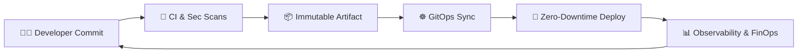

<div align="center">
  

  # Hey, I'm Anatolii 👋

  

  
</div>

<br/>

> **Senior DevOps & Platform Engineer** with 10+ years of experience building scalable cloud infrastructure, resilient CI/CD platforms, and self-service environments for developers. I treat infrastructure as a product and believe in pragmatic, AI-assisted automation to eliminate toil and accelerate delivery. 🚀

From early freelance work and **Modern-Expo** to leadership roles at **Celeno**, **Terabase Energy** and **AD Studio** — I understand infrastructure not just at the tooling level, but at the level of architecture, networking and system interaction.

## 🏆 Impact & Highlights

Instead of just listing technologies, here is what I use them to achieve:

- ⚡ **Delivery Velocity:** Slashed environment provisioning times from **2 days to <30 minutes** using modular Terraform, and accelerated CI/CD build times by **89%** (from 3h to 20m).
- 💰 **Cloud FinOps:** Consistently optimized AWS/GCP resource allocation, driving **25-35% in direct monthly cloud hosting savings** through workload rightsizing and dynamic scaling.
- 🛡️ **Reliability & DevSecOps:** Engineered zero-downtime release pipelines supporting loads of **50,000+ RPM**, and reduced MTTD by **40%** by implementing robust Prometheus/Grafana observability stacks.
- 🤝 **Platform Engineering:** Transformed fragmented legacy systems into unified, automated GitOps workflows, enabling **68+ engineers across 25 parallel projects** to deploy autonomously.

## 🛠 Core Tech Stack

<div align="center">

### Cloud & Virtualization


### Infrastructure as Code & Containers


### CI/CD & GitOps


### Observability & Data


### OS, Networking & Scripting


</div>

## 🧠 Skills & Competencies

<details>
<summary><b>☁️ Cloud Computing & Virtualization</b></summary>

- **Public Cloud:** AWS (EC2, EKS, ECS, RDS, S3, VPC, IAM, CloudWatch), Microsoft Azure (incl. Azure Functions), Google Cloud Platform (GCP), DigitalOcean
- **Hybrid Cloud & Virtualization:** Microsoft Hyper-V, VMware ESXi, Proxmox, Bare-metal / On-Prem Infrastructure
</details>

<details>
<summary><b>🏗️ Infrastructure as Code & Configuration Management</b></summary>

- **Provisioning (IaC):** Terraform (modular approach), AWS CloudFormation
- **Configuration Management:** Ansible, PXE Network Boot
- **Methodologies:** GitOps
</details>

<details>
<summary><b>☸️ Containerization & Orchestration</b></summary>

- **Orchestration:** Kubernetes (K8s), cluster management, dynamic runners
- **Containerization:** Docker, Docker Compose
- **K8s Package Management:** Helm
- **Architecture:** Microservices
</details>

<details>
<summary><b>🔁 CI/CD & Automation</b></summary>

- **Pipelines:** GitLab CI, GitHub Actions, Jenkins, Azure DevOps Pipelines, Bitbucket Pipelines
- **Version Control:** Git, GitHub, GitLab, Bitbucket, Gerrit
- **Specialized:** Hardware-in-the-Loop (HIL) Automation — chip flashing via UART/JTAG
</details>

<details>
<summary><b>📊 Observability, Monitoring & FinOps</b></summary>

| Component | Tools |
|-----------|-------|
| 📈 **Metrics & Monitoring** | Prometheus, Zabbix, Nagios, New Relic |
| 📊 **Visualization** | Grafana |
| 📝 **Logging** | ELK Stack (Elasticsearch, Logstash, Kibana), Loki |
| 💰 **FinOps** | Cloud cost optimization (Rightsizing, Spot/On-Demand Automation), autoscaling automation |
</details>

<details>
<summary><b>🐧 Operating Systems & Scripting</b></summary>

- **Operating Systems:** Linux (Ubuntu, Debian, RHEL, CentOS) with deep understanding of the kernel and system processes, macOS
- **Windows Infrastructure:** Windows Server (Active Directory, GPO)
- **Scripting & Programming:** Bash, Shell Scripting, Python, Groovy (Jenkins)
</details>

<details>
<summary><b>🛡️ Networking, DevSecOps & Security</b></summary>

- **Networking:** TCP/IP, DNS, DHCP, VLAN Segmentation, VPN, RADIUS
- **Web / Proxy:** Nginx, HAProxy, SSL/TLS, Load Balancing, Reverse Proxy
- **DevSecOps:** Vulnerability scanning (Black Duck SCA, SonarQube, Coverity, Trivy), SAST/DAST
- **Access Management:** IAM Policies (Least-Privilege), Secrets Management, SSO, Firewall configuration
</details>

<details>
<summary><b>🗄️ Databases & Data Caching</b></summary>

- **Relational:** PostgreSQL, MariaDB/MySQL (incl. replication and Galera Cluster)
- **In-memory / NoSQL:** Redis, MongoDB
</details>

## 🔄 How I Build Platforms



## 💡 Engineering Philosophy

```python
class PlatformEngineer:
    def __init__(self):
        self.mindset = "Infrastructure as a Product"
        self.ai_approach = "Pragmatic Tool, Not a Replacement"

    def resolve_bottleneck(self, process):
        if process.is_manual():
            return self.automate(with_iac="Terraform/Ansible")
        elif process.is_expensive():
            return self.optimize_finops()
        elif process.is_flaky():
            return self.enhance_observability()
        else:
            return self.empower_developers(with_self_service=True)

    def execute(self):
        while True:
            eliminate_toil()
            improve_developer_experience()
```

## 🤝 Let's Connect

I'm currently based in Alberta, Canada 🇨🇦 and always open to discussing:
- 🏗️ Platform Engineering & Developer Experience (DevEx)
- 💰 Cloud FinOps & Architecture Optimization
- 🤖 Pragmatic AIOps and CI/CD Scaling

<div align="center">

[](https://github.com/VibeDevOpsing)
[](https://linkedin.com/in/anatoliidubyna)

</div>

---

<div align="center">
  <i>"The best infrastructure is the one developers don't have to worry about."</i><br><br>

  
  
</div>
